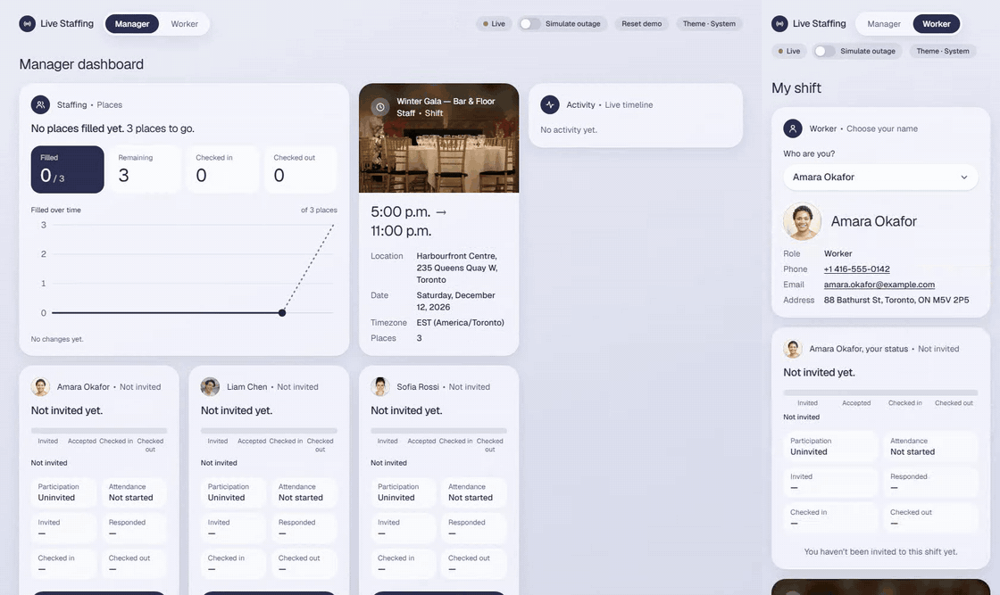
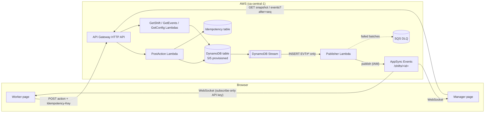

# Live Staffing Dashboard

A worker view and a manager dashboard for one event shift. The manager invites workers, workers accept or
decline, then check in and check out. Every open page sees each change within a few hundred milliseconds,
without a refresh, and catches up on its own after losing its connection. Built on AWS serverless; also
runs entirely on a laptop with no AWS account.

> ### Live demo
>
> **Manager:** <https://auvf58yune.execute-api.ca-central-1.amazonaws.com/manager>
> **Worker:** <https://auvf58yune.execute-api.ca-central-1.amazonaws.com/worker>
>
> Open both side by side. Press **Reset demo** on the manager page to start from the seed.



_Manager dashboard (left) and a worker's phone (right), recorded live by `pnpm demo-gif`: invite, accept, check in, then an outage on the manager page while the worker checks out, and the catch-up._

| At a glance                      |  Local | Cloud (`ca-central-1`) |
| -------------------------------- | -----: | ---------------------: |
| Update delay, median             | 102 ms |                 230 ms |
| Recovery after an outage, median |  28 ms |                 204 ms |
| Monthly cost                     |    n/a |         $0 (free tier) |

## Contents

1. [How to use it](#how-to-use-it)
2. [Run it locally](#run-it-locally)
3. [Reset](#reset)
4. [Deploy to AWS](#deploy-to-aws)
5. [Requirements coverage](#requirements-coverage)
6. [Architecture and design](#architecture-and-design)
7. [Technology choices](#technology-choices)
8. [Testing and measurements](#testing-and-measurements)
9. [Security audit](#security-audit)
10. [Performance evaluation](#performance-evaluation)
11. [Challenges and learnings](#challenges-and-learnings)
12. [Limitations and improvements](#limitations-and-improvements)
13. [Creativity: optional features and what they improve](#creativity-optional-features-and-what-they-improve)
14. [Cost and teardown](#cost-and-teardown)
15. [AI usage](#ai-usage)
16. [Small changes to try](#small-changes-to-try)

## How to use it

The seed is one shift (**Winter Gala**, Harbourfront Centre, Toronto, 17:00–23:00, 3 places) and three
workers (Amara, Liam, Sofia), all Uninvited.

1. Open the **manager** page in one window and the **worker** page in another (or on your phone).
2. On the worker page, choose a name in **Who are you?**
3. On the manager page, press **Invite** on that worker's card. The worker page shows the invitation without
   a refresh.
4. On the worker page, press **Accept** (or **Decline**). Then **Check in**, then **Check out**. An Accepted
   worker can **Cancel** before checking in, and a Cancelled worker can accept again.
5. Watch the manager page: the worker's status and timestamps, the Filled / Remaining / Checked in / Checked
   out counts, the chart and the Activity feed all update live.
6. Try the failure cases:
   - **Double click** any button: one record, timestamps never move.
   - Invite and accept all three workers, then cancel one and try to fill the place twice: the second gets
     "No places left".
   - Turn on **Simulate outage** in the manager header. The pill turns from Live to Offline and the buttons
     are disabled. Make a few changes as the worker, then turn the outage off: the manager catches up, in
     order.
   - **Refresh** either page: every status and timestamp is still there.
7. **Reset demo** (manager header) puts everything back to the seed; every open page snaps back on its own.

The **Theme** pill cycles System → Light → Dark.


|                                 Manager, phone, dark                                 |                              Worker, phone, light                               |                              Worker, phone, dark                              |
| :----------------------------------------------------------------------------------: | :-----------------------------------------------------------------------------: | :---------------------------------------------------------------------------: |
|  |  |  |

## Run it locally

No AWS account needed. Live updates work exactly as in the cloud.

**Requirements:** Docker, Node 22 and pnpm 10 (`corepack enable` gives you the pinned pnpm).

```sh
git clone https://github.com/tarekFerdous/live-staffing-dashboard.git
cd live-staffing-dashboard
pnpm install
docker compose up -d --wait   # DynamoDB Local + local API and live channel + Vite on http://localhost:5173
pnpm reset                    # creates the tables and seeds the shift
```

Open <http://localhost:5173/manager> and <http://localhost:5173/worker>, then follow
[How to use it](#how-to-use-it).

Source is bind-mounted: API changes restart the server and page changes hot-reload. Without the `app`
container, run `pnpm db:up` and then `pnpm dev` (API on :3001, web on :5173, proxied the same way).
`docker compose down` stops everything.

| Command                                    | What it does                                                                 |
| ------------------------------------------ | ---------------------------------------------------------------------------- |
| `pnpm lint && pnpm typecheck && pnpm test` | Lint, types, unit, component and integration tests                           |
| `pnpm e2e`                                 | Playwright end-to-end suite against the running app                          |
| `pnpm smoke:local`                         | One action, checked to arrive over the local WebSocket                       |
| `pnpm measure` / `pnpm measure:render`     | Update-delay and recovery measurements, rendered into this README            |
| `pnpm screenshots`                         | Regenerates `docs/screenshots/` (fails if a page scrolls sideways at 400 px) |
| `pnpm demo-gif`                            | Records `docs/demo.gif` (needs ffmpeg)                                       |

## Reset

Three ways back to the seed, all running the same store code:

- **Reset demo** button in the manager header. A confirmation dialog says exactly what is lost.
- **`POST /api/demo/reset`** (no body), answers `200 { shifts: [{ id, epoch }] }`.
- **CLI:** `pnpm reset` (local, creates tables if needed) or `pnpm reset --stage` (the deployed table).

Open pages snap back without a refresh. A reset puts `seq` back to 0, which a page would otherwise treat as
old, so the shift also has an **epoch** that every reset bumps. A page that sees a newer epoch (in a live
reset message, a catch-up or a snapshot) adopts the server's state, drops pending optimistic actions and
clears its timeline; events from an older epoch delivered late are ignored. The reset deletes META first and
writes it last, so an action during a reset gets `SHIFT_NOT_FOUND` instead of half-applying.

The endpoint has no authentication: it is a demo affordance. A real product would remove it or put it behind
an admin role.

## Deploy to AWS

Region `ca-central-1`, AWS profile `staffing`, everything tagged `project=live-staffing`.

**One-time setup:**

```powershell
$env:BUDGET_ALERT_EMAIL = "you@example.com"   # never committed
pnpm bootstrap:aws                             # BootstrapStack (OIDC role, budget, CFN policy), then cdk bootstrap
gh variable set AWS_DEPLOY_ROLE_ARN --body "arn:aws:iam::<account>:role/live-staffing-github-deploy"
```

**Scoped CloudFormation role ([#84](https://github.com/tarekFerdous/live-staffing-dashboard/issues/84)).**
`cdk bootstrap` gives CDK's CloudFormation execution role AdministratorAccess by default, so anything that
can deploy (CI included) could do anything in the account. `BootstrapStack` creates a managed policy,
`live-staffing-cfn-exec` ([`cfn-exec-policy.ts`](packages/infra/lib/cfn-exec-policy.ts)), that allows only
the services the AppStack uses (DynamoDB, Lambda, API Gateway, AppSync, SQS, Logs, the CDK bootstrap
parameter and assets bucket), and IAM only on roles and policies named `LiveStaffingApp-*`. The only
managed policy it can attach is Lambda's basic logging role. `pnpm bootstrap:aws` deploys `BootstrapStack`
first, then runs `cdk bootstrap` with that policy
([`scripts/cdk-bootstrap.ts`](packages/infra/scripts/cdk-bootstrap.ts)), so re-running it never restores
AdministratorAccess. On an account bootstrapped the old way, the same re-bootstrap by hand is:

```powershell
$env:AWS_PROFILE = "staffing"
$acct = aws sts get-caller-identity --query Account --output text
pnpm --filter @staffing/infra exec cdk bootstrap "aws://$acct/ca-central-1" `
  --cloudformation-execution-policies "arn:aws:iam::${acct}:policy/live-staffing-cfn-exec"
```

Verified 2026-11-12: after the re-bootstrap, `cdk-hnb659fds-cfn-exec-role-…` has only `live-staffing-cfn-exec`
attached (no AdministratorAccess), and AppStack deploys under it succeeded: a no-op update, one that added a
function (role, inline policy, log group, Lambda), and one that removed it again. `BootstrapStack` itself deploys with your own CLI credentials (`CliCredentialsStackSynthesizer`), not
through the scoped role, because it manages IAM, the OIDC provider and the budget. Residual risk: the
stack's own Lambda roles can still be given any inline policy, so a malicious change merged to `main` could
deploy a function with broad rights. Branch protection (below) is what stops that change from landing
unreviewed by CI; a permissions boundary on the stack's roles would close it fully.

**Branch protection ([#85](https://github.com/tarekFerdous/live-staffing-dashboard/issues/85)).** `main`
requires the `checks` and `local-smoke` CI jobs to pass, applies to admins too, needs no review (one
developer), and refuses force pushes and deletion. So every change lands through a PR with green CI.
Apply or re-apply it with:

```powershell
gh api -X PUT repos/tarekFerdous/live-staffing-dashboard/branches/main/protection --input .github/branch-protection.json
```

**Deploy:**

```powershell
$env:AWS_PROFILE = "staffing"
pnpm run deploy          # builds the web app, deploys AppStack, prints SiteUrl / ApiUrl / TableName
pnpm run deploy:hotswap  # dev only: pushes Lambda code changes in seconds
```

Use `pnpm run deploy`, not `pnpm deploy` (a built-in pnpm command). The stack seeds the shift when first
created. Forks deploying to their own account change `GITHUB_SUBJECT_PREFIX` in `packages/infra/lib/config.ts`.

**CI/CD** (`.github/workflows/ci.yml`):

- **Every push and PR:** lint, typecheck, unit and integration tests against a DynamoDB Local service
  container, then local mode (`docker compose up`, reset, smoke test, Playwright). No AWS credentials.
- **Push to `main`:** assumes the deploy role through OIDC (no stored keys), deploys, then smoke-tests the API,
  the security headers, and one live update over AppSync Events. The role trusts only `main` of this repo via
  GitHub's immutable OIDC subject, and can only assume the `cdk-*` roles.
- **Monthly (1st, 06:17 UTC) and on demand (`workflow_dispatch`):** the same deploy. The browsers' AppSync
  subscribe key expires 365 days after the deploy that last synthesized it (`Expiration.after`, tested to land
  360–366 days after synth time), so each deploy pushes its expiry a year out. The monthly run means the key
  can't lapse even if nothing changes for a year, and the deploy path stays exercised
  ([#86](https://github.com/tarekFerdous/live-staffing-dashboard/issues/86)).
- **Supply chain ([#83](https://github.com/tarekFerdous/live-staffing-dashboard/issues/83)):** every action is
  pinned to a full commit SHA (with a `# vX.Y.Z` comment), and CI fails if a `uses:` isn't. Dependabot opens
  weekly PRs: npm minor and patch updates grouped, majors one by one, and action SHA bumps.

### Site hosting (temporary): why there is no CloudFront

The design serves the site from S3 behind CloudFront. Creating the distribution fails until AWS Support
verifies the account ("Your account must be verified before you can add new CloudFront resources"). Rather
than block every deploy, the built app ships as a Lambda layer served by a small `Site` Lambda on catch-all
`GET /` and `GET /{proxy+}` routes of the same HTTP API. The `/api/*` routes are more specific and win, so page
and API still share one origin (no CORS), and `/assets/` files are cached for a year. The cost is one Lambda
call per page or asset load and no edge caching. The CloudFront + S3 version is in commit `706197f`;
`todo.md` says how to restore it.

## Requirements coverage

| Requirement                                                                                                | Where                                                                       |
| ---------------------------------------------------------------------------------------------------------- | --------------------------------------------------------------------------- |
| One shift, 3 places, 3 named workers initially Uninvited; title, date, times, location                     | `packages/store/src/seed.ts`                                                |
| Worker view: select, accept/decline, check in/out; no login                                                | `/worker`, `WorkerPage.tsx`                                                 |
| Manager: invite, shift details, statuses, check-in/out timestamps, filled/remaining, checked-in/out counts | `/manager`, `ManagerPage.tsx`                                               |
| Participation and Attendance with the PDF's transition rules                                               | `packages/domain/src/transitions.ts` (one table, exhaustively tested)       |
| Counts include Checked in/out and always agree with the list                                               | Derived from the list by `deriveCounts`, never stored for display           |
| Live updates without refresh                                                                               | DynamoDB Stream → publisher → AppSync Events WebSocket                      |
| Saved and validated by a backend; refresh keeps state                                                      | Zod-validated, conditional DynamoDB transaction, server timestamps          |
| Repeated clicks and retries are harmless; useful errors                                                    | Idempotency keys, versioned rows, `if_not_exists` timestamps, readable 409s |
| Show when live is unavailable; catch up automatically                                                      | Live pill, disabled buttons, subscribe-then-catch-up by `seq`               |
| Measure update delay and recovery                                                                          | [Measurements](#measurements)                                               |

## Architecture and design



| Package              | What it holds                                                                                          |
| -------------------- | ------------------------------------------------------------------------------------------------------ |
| `packages/domain`    | Statuses, transition table, `applyAction`, `deriveCounts`, Zod schemas. No AWS or React imports.       |
| `packages/store`     | DynamoDB single-table repository, seed data, reset script, test helpers.                               |
| `packages/functions` | Lambda handlers, the stream publisher, and a local HTTP + WebSocket adapter that calls the same code.  |
| `packages/web`       | React + Vite + TanStack Query + Tailwind. Routes `/manager` and `/worker`.                             |
| `packages/infra`     | CDK: `BootstrapStack` (OIDC role, budget) and `AppStack` (tables, API, Lambdas, AppSync Events, site). |
| `packages/e2e`       | Playwright suite and the measurement scripts.                                                          |

### Data model

One partition per shift (`PK = SHIFT#<id>`):

| SK            | Item                                                                                                 |
| ------------- | ---------------------------------------------------------------------------------------------------- |
| `META`        | title, location, startsAt/endsAt (UTC), timezone (IANA), required, `seq`, `epoch`, `acceptedCount`   |
| `WORKER#<id>` | name, participation, attendance, four timestamps, `version`                                          |
| `EVT#<seq>`   | append-only event log: `{ seq, epoch, type, workerId, actor, row, at }` with the full new worker row |

A worker's state is two independent fields: **participation** (Uninvited → Invited → Accepted / Declined →
Cancelled) and **attendance** (Not started → Checked in → Checked out). Every allowed move is one row of data
in `packages/domain/src/transitions.ts`, used by the server, the optimistic client and the button list alike.

Sort keys order as `EVT#…` < `META` < `WORKER#…`, so the snapshot is one Query with `SK >= "META"` and never
reads the event log. Counts are derived on the client from the worker rows; `acceptedCount` on META exists
only to enforce capacity atomically.

### Update mechanism

1. The worker presses **Accept**. The page shows the expected result at once (predicted by the same domain
   rules) and sends `POST /api/shifts/{shiftId}/workers/{workerId}/actions` with an `Idempotency-Key`.
2. The action Lambda commits the change and its event in one transaction and answers with the row and `seq`.
3. The table's stream delivers the new `EVT#` item to the publisher Lambda. The event source mapping is
   filtered to `EVT#` inserts (plus META inserts, which only a reset makes), so a rolled-back transaction is
   never announced.
4. The publisher posts to the AppSync Events channel `/shifts/<id>`; every subscribed page receives it.
5. Each page applies an event only if it is exactly the next `seq`. A duplicate is dropped; a gap triggers a
   catch-up read of `GET …/events?after=<seq>` (single-flight, falling back to a snapshot after 200 events).
6. A push can be lost (AppSync Events is at-most-once), and a lost _last_ event has no later event to reveal
   the gap. So while Live, a page also reads what it missed 1.5 s after a burst goes quiet and every 6 s.
   Each read is one DynamoDB Query that returns the missed events and the shift's epoch together
   (`EVT#<seq+1> … META`). The routine 6 s read is eventually consistent, at half the cost; gap catch-ups and
   the read after a burst stay strongly consistent, and a read that lags behind can never roll a page back.
7. A **hidden tab** closes its connection and stops reading. Shown again, it starts as on first load.

On connect and every reconnect, the page **subscribes first, then reads what it missed**, so nothing
committed in between is lost. Reconnects use jittered backoff (250 ms doubling to 5 s). While not Live, action
buttons are disabled with a notice. **Simulate outage** closes the live connection on purpose.

**Why this mechanism:** publishing from the stream means only committed changes are ever pushed, and retries
and a DLQ come for free. AppSync Events gives managed WebSocket fan-out without a connection table. A per-shift
`seq` turns "did I miss something?" into a number comparison, which makes recovery deterministic.

### Safe writes

Each action is one read of META and the worker row, then one `TransactWriteItems`:

1. **Worker row:** updated only from an allowed from-state and the version that was read; `version + 1`;
   its timestamp set with `if_not_exists`, so it never moves.
2. **META:** `seq = seq + 1` only if `seq` is unchanged. `accept` also requires `acceptedCount < required`.
3. **Event:** `EVT#<seq>` with the full new row.

On contention the Lambda re-reads and decides again (3 retries, jittered). Timestamps come from the Lambda's
clock, not the browser's. Idempotency uses Powertools for AWS Lambda, keyed on the header plus path, with a
1-hour TTL; a repeated key returns the byte-identical first response.

| Outcome                                                   | Response                                        |
| --------------------------------------------------------- | ----------------------------------------------- |
| Applied                                                   | `200 { worker, seq }`                           |
| Already in the target state (double click, lost response) | `200 { worker }`, no new event                  |
| Stale `expectedVersion`                                   | `409 VERSION_CONFLICT` with `current`           |
| Not allowed from the current state                        | `409 INVALID_TRANSITION` with a readable reason |
| No free place                                             | `409 SHIFT_FULL`, "No places left"              |
| Malformed body or missing key                             | `422`                                           |
| Same key, different body                                  | `422 IDEMPOTENCY_KEY_REUSED`                    |

### Key trade-offs

- **One extra hop for correctness.** Stream-based publishing adds ~110 ms (median) but never announces a
  change that didn't commit.
- **Serialised writes per shift.** `seq` gives a total order; the price is contention at tens of writes per
  second on one shift.
- **Serverless over containers.** Nothing idle to pay for; the price is a cold start after idle (~1.3 s to the
  first action, [Cold starts](#cold-starts)).
- **A safety-net read every 6 s** turns a lost push into a few seconds' delay; the price is steady reads per
  open page (see [Cost](#cost-and-teardown)).

### Local mode

The same handlers run behind three ports, with a cloud and a local adapter each. The page reads
`GET /api/config` at start-up to find its live channel, so one web build runs in both.

| Port              | Cloud                                          | Local                                                       |
| ----------------- | ---------------------------------------------- | ----------------------------------------------------------- |
| `AssignmentStore` | DynamoDB                                       | DynamoDB Local (same code, other endpoint)                  |
| `ChangeFeed`      | DynamoDB Streams → Lambda event source mapping | polls DynamoDB Local's stream API                           |
| `Publisher`       | AppSync Events HTTP publish (SigV4)            | in-process `ws` server speaking the AppSync Events protocol |

## Technology choices

| Choice                                  | Why                                                                                                                                                          | Alternatives considered                                                                                                                                                                                                           |
| --------------------------------------- | ------------------------------------------------------------------------------------------------------------------------------------------------------------ | --------------------------------------------------------------------------------------------------------------------------------------------------------------------------------------------------------------------------------- |
| **Lambda + API Gateway HTTP API**       | Pay per request, nothing idle, no servers to patch.                                                                                                          | **A container** (Fastify on Fargate / App Runner, in-process WebSockets): no cold starts, but $20–30/month around the clock and sticky sessions or pub/sub once there are two instances. The local server already is that design. |
| **DynamoDB, single table**              | Conditional writes and transactions give exactly the guarantees needed (versioned rows, atomic capacity, ordered log) with no connection pooling. Free tier. | **Aurora Serverless / RDS Postgres**: `SELECT … FOR UPDATE` is natural, but not free, and Lambda needs RDS Proxy.                                                                                                                 |
| **DynamoDB Streams → publisher**        | Only committed changes are published. Retries and a DLQ for free.                                                                                            | Publishing from the action Lambda: one hop faster, but a crash between commit and publish loses the event.                                                                                                                        |
| **AppSync Events**                      | Managed WebSocket fan-out to channels, IAM-only publish, subscribe-only key.                                                                                 | **API Gateway WebSocket API** (you manage connection ids), **IoT Core MQTT** (heavier client), **SSE / polling** (long-lived server, or constant requests).                                                                       |
| **Per-shift `seq` + catch-up endpoint** | Total order, so clients detect duplicates and gaps and recover deterministically.                                                                            | Refetching the snapshot on every message: more reads, no ordering.                                                                                                                                                                |
| **React + TanStack Query + Tailwind**   | The query cache is the single source of truth; sync and optimistic actions both write to it.                                                                 | Plain fetch + `useState` (re-invents caching), Redux (more ceremony).                                                                                                                                                             |
| **CDK in TypeScript**                   | Same language as the app; infra imports constants from the store package.                                                                                    | SAM / Serverless Framework (YAML), Terraform (another language and state backend).                                                                                                                                                |
| **Playwright**                          | Two browser contexts in one test and WebSocket routing for the stale-page test.                                                                              | Cypress (two sessions are awkward).                                                                                                                                                                                               |
| **GitHub Actions + OIDC**               | Deploys with no stored AWS keys, trusting only `main` of this repo.                                                                                          | Long-lived access keys in secrets.                                                                                                                                                                                                |

## Testing and measurements

```sh
pnpm lint && pnpm typecheck && pnpm test   # unit, component, integration, infra
pnpm e2e                                   # end to end against `docker compose up` (or BASE_URL)
```

About 550 test cases across 52 files.

| What the PDF asks to test | How                                                                                                                                                                                                                                                              |
| ------------------------- | ---------------------------------------------------------------------------------------------------------------------------------------------------------------------------------------------------------------------------------------------------------------- |
| **Status transitions**    | Domain unit tests run every participation × attendance combination against every action, allowed and refused. The e2e suite runs the full lifecycle, decline → re-invite and cancel → re-accept across two real browsers.                                        |
| **Illegal actions**       | Handler tests check every refusal and its reason against DynamoDB Local. Pages show only allowed buttons per state (e2e), and a refused optimistic action is rolled back with the server's message (e2e, using a page made stale on purpose).                    |
| **Counts**                | Unit tests for every count combination; handler tests check `acceptedCount` always equals the derived count; 3 workers racing for 2 places end with exactly 2 accepted.                                                                                          |
| **Repeated actions**      | 20 parallel identical requests produce one event; same key replays byte-identically; a reused key with a different body is refused; e2e double clicks never create a second event or move a timestamp.                                                           |
| **Connection recovery**   | Client sync tests with a fake transport and clock: ordered apply, duplicates, gaps, catch-up, backoff, offline, resets. E2E: three changes made during a manager outage all appear after reconnecting; a hidden tab makes no requests and catches up when shown. |

Also covered: publisher filtering and the local adapters, the stream filter and IAM boundaries (CDK
assertions), and **accessibility** (axe-core WCAG 2.1 AA on both pages, light and dark, desktop and 400 px).
The e2e suite runs in CI against local mode, or against the deployed stage with `BASE_URL=<SiteUrl> pnpm e2e`.

### Measurements

Produced by `pnpm measure` (local) and `pnpm measure --stage`, written to `packages/e2e/results/*.json`, and
rendered below by `pnpm measure:render`, so no number is typed by hand.

- **Update delay:** worker clicks Accept or Cancel (alternating, 100 runs) → the manager's page shows the new
  status. Both moments are stamped inside the browser, so Playwright's round trips aren't counted, and both
  pages share one machine's clock.
- **Recovery:** manager in simulated outage, worker makes 3 changes, outage off → manager matches the server
  snapshot. 20 runs.
- **Cold start:** fresh Lambda instances forced on the stage; the first action (to the manager's page and to
  the worker's answer) and the first snapshot are reported on their own rows. `pnpm measure --stage
--cold-only` repeats just these; `pnpm cold-starts` reports each function's init time.
- Runs are paced so the provisioned table is never throttled; the script reads the throttle metric to confirm.

<!-- measurements:start -->

| Metric                                                              |       Local (docker compose) | Cloud (ca-central-1) |
| ------------------------------------------------------------------- | ---------------------------: | -------------------: |
| Update delay p50                                                    |                       102 ms |               224 ms |
| Update delay p95                                                    |                       110 ms |               366 ms |
| Update delay max                                                    |                       124 ms |               653 ms |
| Update delay runs                                                   |                          100 |                  100 |
| Recovery p50                                                        |                        28 ms |               207 ms |
| Recovery p95                                                        |                        32 ms |               260 ms |
| Recovery max                                                        |                        33 ms |               713 ms |
| Recovery runs                                                       |                           20 |                   20 |
| Cold first action: click → manager sees it (not in the percentiles) | n/a (no cold starts locally) |              1709 ms |
| Cold first action: click → worker gets the answer                   |                          n/a |               820 ms |
| Cold first snapshot (GET shift)                                     |                          n/a |               544 ms |
| DynamoDB throttle events during the run                             |                          n/a |                    0 |

Cloud path per hop (Powertools metrics read back from CloudWatch for the same run):

| Hop                                                                               |    p50 |    p95 |    max | samples |
| --------------------------------------------------------------------------------- | -----: | -----: | -----: | ------: |
| Action Lambda: request in → response out                                          |  36 ms |  63 ms | 200 ms |     160 |
| Event timestamp → publisher starts (DynamoDB write, stream, event source mapping) | 126 ms | 490 ms | 533 ms |     160 |
| Publisher → AppSync Events HTTP publish                                           |  35 ms |  97 ms | 140 ms |     160 |

The rest of the update delay is the browser → API Gateway → Lambda round trip and AppSync fan-out to the
manager's WebSocket and React rendering. The command and commit-to-publisher hops overlap: the event's
timestamp is taken inside the action Lambda.

- **Local**, measured 2026-11-11 11:49 UTC (41 s): Windows_NT 10.0.26200 (x64), AMD Ryzen 7 9800X3D 8-Core Processor × 8, 31 GB, Node v22.18.0, Chromium 158.0.8127.18 (headless). Sequential runs, 200 ms apart, docker compose local mode on this machine.
- **Cloud**, measured 2026-11-13 10:50 UTC (159 s): Windows_NT 10.0.26200 (x64), AMD Ryzen 7 9800X3D 8-Core Processor × 8, 31 GB, Node v22.18.0, Chromium 158.0.8127.18 (headless). Sequential runs, 1000 ms apart, browser on this machine → ca-central-1.

<!-- measurements:end -->

Locally, most of the update delay is the change feed's 100 ms poll of DynamoDB Local's stream. In the cloud,
the stream hop is the largest and most variable part: the price of publishing only committed changes.

## Security audit

Audited 2026-11-11: handlers, IAM and CI were read line by line, the live site was probed, and `pnpm audit`
was run. Severity is for the code as deployed, judged as if it held real data (the demo's people are made up).

| Severity | Finding                                                                                                                                                                                                                        | Fix                                                                                                                          | Status                                                                                                                                                                   |
| -------- | ------------------------------------------------------------------------------------------------------------------------------------------------------------------------------------------------------------------------------ | ---------------------------------------------------------------------------------------------------------------------------- | ------------------------------------------------------------------------------------------------------------------------------------------------------------------------ |
| **High** | **No authentication or authorisation.** Anyone can act as any worker or the manager, and reset the demo.                                                                                                                       | Cognito (`workerId` claim, manager group), a JWT authorizer, an actor check in PostAction; remove or gate `/api/demo/reset`. | Open: the auth milestone. Reset is now throttled to 1 rps ([#77])                                                                                                        |
| **High** | **No rate limiting.** No API throttle and a 5-read-unit table: a few dozen requests a second exhaust it for everyone. Lambda and API Gateway spend is uncapped (email alert only).                                             | HTTP API stage throttling (e.g. 20 rps, burst 40), reserved concurrency per function, WAF rate rules with CloudFront.        | **Mitigated** ([#77]): 50/100 default, actions 10/20, reset 1/2, a clear 429 message. No reserved concurrency: the account limit is 10 (see [Rate limits](#rate-limits)) |
| Medium   | **Personal data visible to anyone.** The snapshot and every live event carry each worker's phone, email and address; the public subscribe key opens every `/shifts/*` channel.                                                 | Contact details only for the manager and the worker themselves, none in events, a per-channel AppSync authorizer.            | Open: deferred to the auth milestone                                                                                                                                     |
| Medium   | **Missing security headers.** No CSP, HSTS, `frame-ancestors` or Referrer-Policy, so the dashboard can be framed (clickjacking Invite / Reset).                                                                                | Set them in the Site Lambda now, or with a CloudFront response-headers policy.                                               | **Fixed** ([#75]): strict CSP, HSTS, Referrer-Policy, Permissions-Policy; `nosniff` on JSON too                                                                          |
| Medium   | **Vulnerable library in a production path.** `pnpm audit --prod`: zod 3.x (high, memory exhaustion on oversized input; runs in PostAction), react-router 6 (2 moderate: SSR hydration and backslash links, neither used here). | Upgrade zod and react-router.                                                                                                | **Fixed** ([#79], [#80]): zod 4, react-router 7; `pnpm audit --prod` is clean. Bodies over 1 KB get 413 before parsing ([#76])                                           |
| Medium   | **CI is effectively admin.** The deploy role can only assume `cdk-*` roles, but CDK's default CloudFormation role has AdministratorAccess, so a push to `main` controls the account.                                           | Bootstrap with scoped `--cloudformation-execution-policies`; branch protection with required review.                         | **Mitigated** ([#84], [#85]): scoped execution policy, `main` protected with required CI. Inline policies on the stack's own roles remain (see Deploy)                   |
| Low      | GitHub Actions pinned to major tags, not commit SHAs.                                                                                                                                                                          | Pin to SHAs, let Dependabot bump them.                                                                                       | **Fixed** ([#83]): SHA-pinned, CI rejects tags, Dependabot weekly                                                                                                        |
| Low      | The AppSync subscribe key expires after 365 days; live updates would stop quietly.                                                                                                                                             | Rotate on deploy or alarm before expiry (auth removes the key).                                                              | **Fixed** ([#86]): every deploy moves the expiry a year out (tested); a monthly scheduled deploy                                                                         |
| Low      | Demo-grade data protection: `RemovalPolicy.DESTROY`, no point-in-time recovery, AWS-owned key.                                                                                                                                 | PITR, deletion protection, `RETAIN`, a customer-managed key.                                                                 | Open: accepted for a demo                                                                                                                                                |
| Low      | Dev-only advisories (28 of 31): tinypool via vitest (critical), undici / busboy via testcontainers. Not shipped.                                                                                                               | Bump vitest and testcontainers.                                                                                              | **Fixed** ([#81], [#82]): vitest 4, testcontainers 12, esbuild 0.25. 3 moderate left (glob / minimatch, dev only)                                                        |

[#75]: https://github.com/tarekFerdous/live-staffing-dashboard/issues/75
[#76]: https://github.com/tarekFerdous/live-staffing-dashboard/issues/76
[#77]: https://github.com/tarekFerdous/live-staffing-dashboard/issues/77
[#79]: https://github.com/tarekFerdous/live-staffing-dashboard/issues/79
[#80]: https://github.com/tarekFerdous/live-staffing-dashboard/issues/80
[#81]: https://github.com/tarekFerdous/live-staffing-dashboard/issues/81
[#82]: https://github.com/tarekFerdous/live-staffing-dashboard/issues/82
[#83]: https://github.com/tarekFerdous/live-staffing-dashboard/issues/83
[#84]: https://github.com/tarekFerdous/live-staffing-dashboard/issues/84
[#85]: https://github.com/tarekFerdous/live-staffing-dashboard/issues/85
[#86]: https://github.com/tarekFerdous/live-staffing-dashboard/issues/86

**Dependency audit, before → after:**

| `pnpm audit`      | Critical | High | Moderate | Low |
| ----------------- | -------: | ---: | -------: | --: |
| `--prod` before   |        0 |    1 |        2 |   0 |
| `--prod` after    |        0 |    0 |        0 |   0 |
| Whole tree before |        2 |    7 |       19 |   3 |
| Whole tree after  |        0 |    0 |        3 |   0 |

The 3 moderate left are `glob` / `minimatch` reached only through testcontainers' archiver and
typescript-eslint (dev tooling, never shipped); Dependabot will pick up fixed versions when they publish.

### Edge hardening: probes against the deployed site

Run 2026-11-12 against the stage after [#75]–[#77] deployed.

- **Headers** (`curl -sD - -o /dev/null $SITE_URL/manager`): `content-security-policy: default-src 'self';
script-src 'self'; style-src 'self'; img-src 'self' data:; connect-src 'self' https://<appsync-http-host>
wss://<appsync-realtime-host>; frame-ancestors 'none'; base-uri 'none'; form-action 'none'`, plus
  `strict-transport-security: max-age=31536000; includeSubDomains`, `referrer-policy: no-referrer`,
  `permissions-policy: camera=(), microphone=(), geolocation=()` and `x-content-type-options: nosniff` (also on
  every JSON API response). The theme script that ran inline before first paint is now `/theme-init.js`, so the
  CSP needs no `'unsafe-inline'`. CI checks these headers after every deploy, and the Playwright suite fails on
  any CSP violation. That guard caught one at once: zod 4 probes `new Function` to compile faster parsers,
  which `script-src 'self'` blocks, so the browser sets `z.config({ jitless: true })` before any parse
  (`packages/web/src/lib/zodConfig.ts`) rather than allowing `'unsafe-eval'`. With that, all 26 e2e tests pass
  against the stage, with live updates and catch-up working.
- **Body cap:** a 1,025-byte action body →
  `413 {"code":"PAYLOAD_TOO_LARGE","message":"The request body is too large (at most 1024 bytes)."}`; the store
  is never called.

### Rate limits

API Gateway throttles the HTTP API stage per route ([#77]): **50 rps, burst 100** by default (page loads,
snapshots, the 6 s safety-net reads), **10 / 20** on `POST …/actions`, and **1 / 2** on `POST /api/demo/reset`.
Over the limit, API Gateway answers `429 {"message":"Too Many Requests"}` before any Lambda or table is touched,
and both pages show "Too many requests, try again".

Probe (resets the demo; Git Bash):

```bash
for i in $(seq 1 20); do curl -s -o /dev/null -w '%{http_code} ' -X POST "$SITE_URL/api/demo/reset"; done
```

Result: `429 200 200 429 200 429 429 429 200 429 429 200 429 200 429 429 200 429 200 429`, about one reset a
second gets through. Throttling is per API Gateway node and best effort, so a burst of parallel calls can
briefly get more through; it bounds sustained load, not every single request. Thirty quick action calls
stayed under the action limit (no 429), and the e2e suite and `pnpm measure --stage` saw no 429s.

**Reserved concurrency: off.** `aws lambda get-account-settings` reports a concurrent-execution limit of
**10** for this account (new accounts start low), and AWS keeps at least 10 unreserved, so nothing can be
reserved. The switch is `RESERVED_CONCURRENCY` in `packages/infra/lib/app-stack.ts` (PostAction 5, the others
3). Turn it on once a quota increase raises the limit to 1,000. Until then, the account limit of 10 is itself
the cap on parallel Lambda spend, and the stage throttles bound the request rate.

**What held up:** path traversal probes against the live Site Lambda (`%2e%2e`, `%2f`, `%5c`) never return a
file outside the build; every input is validated (Zod body, strict Idempotency-Key pattern, digits-only
`after`); idempotency records are scoped to key + path and a reused key with a different body is refused;
least-privilege IAM per Lambda, IAM-only publish and subscribe-only browsers; a cancelled write can never be
pushed; no stored AWS keys (OIDC, `main` only, immutable subject) and PRs never get credentials; 500s carry a
generic message; no `dangerouslySetInnerHTML` or `eval`; no secrets in the repo; the DLQ requires TLS; a
budget alert at $0.01.

## Performance evaluation

From the [measurements](#measurements), production builds and live probes: before on 2026-11-11, after on
2026-11-13.

| What                                         |                          Before |                                                After | Status                      |
| -------------------------------------------- | ------------------------------: | ---------------------------------------------------: | --------------------------- |
| Update delay, cloud                          |          p50 230 ms, p95 681 ms |                               p50 224 ms, p95 366 ms | Good                        |
| Recovery after an outage, cloud              |          p50 204 ms, max 324 ms |                               p50 207 ms, max 713 ms | Good                        |
| Action Lambda, warm                          |            p50 49 ms, p95 97 ms |                                 p50 36 ms, p95 63 ms | Good                        |
| Write → publisher (stream hop)               |          p50 111 ms, p95 509 ms |                               p50 126 ms, p95 490 ms | Open (finding 6)            |
| First action after idle: manager sees it     |                        2,530 ms |                     1,349 ms (median of 5 cold runs) | **Fixed** ([#94])           |
| First action after idle: worker's answer     |                               — |                                               686 ms | **Fixed** ([#94])           |
| First snapshot after idle                    |                        1,249 ms |                                               544 ms | **Fixed** ([#94])           |
| JavaScript a worker downloads on first visit |  354 KB, uncompressed, one file |       82 KB Brotli (92 KB gzip), its own chunks only | **Fixed** ([#88], [#89])    |
| CSS / shift photo / Latin font               |   29 KB / 131 KB / 29 KB, as is |     6 KB Brotli / 131 KB / 29 KB (no re-compressing) | **Fixed** ([#88])           |
| Safety-net read per open page every 6 s      |    Query + GetItem, both strong | one eventually consistent Query; none in hidden tabs | **Mitigated** ([#91]–[#93]) |
| Snapshot / empty catch-up payload            |                   1.2 KB / 41 B |                                        1.2 KB / 41 B | Tiny                        |
| Repeat visits                                | assets cached 1 year, immutable |                                            unchanged | Good                        |

Findings, most important first:

1. **Responses weren't compressed.** **Fixed** ([#88]): the build writes Brotli and gzip copies of every text
   file over 1 KB, and the Site Lambda sends the best one the browser accepts (`Vary: Accept-Encoding`).
2. **One bundle for both pages.** **Fixed** ([#89]): `/manager`, `/worker` and the reset dialog load lazily,
   with a small loading state and a reload prompt if a chunk is gone after a deploy. A build test keeps the
   worker route at 92 KB gzipped or less and none of the manager's code in it.
3. **Cold starts:** ~2.5 s for the first action, ~1.2 s for the first snapshot. **Fixed** ([#94]): 1.3 s and
   0.5 s, see [Cold starts](#cold-starts).
4. **Safety-net reads cap open pages.** Each Live page made a strongly consistent Query + GetItem every 6 s;
   a few dozen pages used up 5 read units. **Mitigated** ([#91]–[#93]): one Query returns the events and the
   epoch, the routine read is eventually consistent, hidden tabs stop. The request per check remains, so
   the cost falls less than the reads ([Cost](#cost-and-teardown)); a server heartbeat is the next step.
5. **The libraries are most of the bundle.** react-dom, react-router, TanStack Query and zod are about 75 KB
   gzipped of the worker's 92 KB, so the PRD's 76 KB target was out of reach without replacing one. zod moved
   to `zod/mini` (the same validation, a third of the size).
6. **The stream hop sets the tail.** If latency mattered more than the stream's guarantee, publish straight
   from PostAction after the commit and keep the stream as a fallback (pages already drop duplicates by `seq`).

Already efficient: the snapshot is one Query that never reads the log, counts are derived, payloads are
small, Lambdas are arm64 minified ESM, one request per action, no UI or chart library.

### First load: what each route downloads

JavaScript per route (the entry, the page's own chunk and their shared chunks), from production builds:

| Route      | Before: raw (sent as is) |   gzip | Brotli | After: raw |  gzip | Brotli (sent) |
| ---------- | -----------------------: | -----: | -----: | ---------: | ----: | ------------: |
| `/worker`  |                   354 KB | 118 KB | 104 KB |     273 KB | 92 KB |         82 KB |
| `/manager` |                   354 KB | 118 KB | 104 KB |     278 KB | 95 KB |         84 KB |
| CSS (both) |                    29 KB |   7 KB |   6 KB |      29 KB |  7 KB |          6 KB |

On the deployed site, the main chunk is 187,735 bytes raw, 62,079 with `Accept-Encoding: gzip` and 54,729 with
`br` (29% of raw), with `content-encoding`, `Vary: Accept-Encoding` and the one-year immutable cache header; CI
checks the `br` response after every deploy. A worker's first visit now moves about a quarter of the
JavaScript it did. ("Before" is the build just before this work: zod 4 and react-router 7 had already
grown the 311 KB the audit measured.) Worker photos are now separate files rather than base64 inside the JS.

### Cold starts

Each function forced cold and invoked directly (`pnpm cold-starts`, 3 runs each, median; Lambda's own
REPORT line). _First run_ is the handler's first invocation, where the first DynamoDB call sets up the SDK and
its TLS connection.

| Function   | Before: init | first run | After: init | first run |
| ---------- | -----------: | --------: | ----------: | --------: |
| GetShift   |       344 ms |    677 ms |      194 ms |    238 ms |
| GetEvents  |       427 ms |    527 ms |      304 ms |    211 ms |
| PostAction |       341 ms |    636 ms |      244 ms |    298 ms |
| DemoReset  |       438 ms |    678 ms |      310 ms |    334 ms |
| Publisher  |       361 ms |     37 ms |      193 ms |      4 ms |
| Site       |       105 ms |     10 ms |      120 ms |      4 ms |
| GetConfig  |        77 ms |      3 ms |      135 ms |      3 ms |

(Site and GetConfig load no SDK; their difference is noise between runs.) What changed, measured one step at
a time on PostAction (init + first run):

| Step                                                                                |  PostAction cold |
| ----------------------------------------------------------------------------------- | ---------------: |
| Before: 256 MB, runtime SDK, zod classic (~826 KB of zod source per function)       |           976 ms |
| Server bundles on `zod/mini` with only the English messages: 300–500 KB → 31–100 KB | 1,033 ms (noise) |
| AWS SDK bundled as tree-shaken ESM instead of the runtime's CommonJS copy           |           968 ms |
| **512 MB** (chosen)                                                                 |       **537 ms** |
| 1,024 MB                                                                            |           381 ms |

The first DynamoDB call is CPU-bound (SDK setup, endpoint rules, request signing), and Lambda's CPU scales
with memory, so 512 MB halves it. 1,024 MB saves another ~150 ms for twice the price per millisecond; 512 MB
already meets the target. The idempotency layer is also built on the first request instead of at load.

End to end (`pnpm measure --stage --cold-only`, 5 runs with GetShift, PostAction and Publisher forced cold):
click → the manager sees the change took 1,177, 1,231, 1,349, 1,655 and 1,709 ms (median **1,349 ms**,
before 2,530 ms); click → the worker's answer 508–820 ms (median 686 ms); the first snapshot 523–792 ms
(median 544 ms, before 1,249 ms). The slowest runs still pass 1.5 s: after the action, the Publisher's
own cold start and the stream hop come on top. Provisioned concurrency would remove the rest
([Cost](#cost-and-teardown)).

[#88]: https://github.com/tarekFerdous/live-staffing-dashboard/issues/88
[#89]: https://github.com/tarekFerdous/live-staffing-dashboard/issues/89
[#91]: https://github.com/tarekFerdous/live-staffing-dashboard/issues/91
[#93]: https://github.com/tarekFerdous/live-staffing-dashboard/issues/93
[#94]: https://github.com/tarekFerdous/live-staffing-dashboard/issues/94

## Challenges and learnings

- **The snapshot query in the PRD matched nothing.** It said `SK < "EVT#"`, but `META` and `WORKER#` sort
  after `EVT#`. Writing the integration test first caught it (`SK >= "META"`).
- **Pages must subscribe before they read.** Reading first leaves a window where a change is committed but
  neither in the snapshot nor received live.
- **A cancelled transaction must never be pushed.** Publishing from the stream, filtered to new event items,
  gives that for free.
- **CloudFront was blocked by account verification**, which stopped every deploy. Serving the app from a
  Lambda on the same HTTP API kept one origin and unblocked the work; restoring CloudFront is contained.
- **GitHub's immutable OIDC subject** (`owner@id/repo@id`) broke the first CI deploy because the role trusted
  the legacy form. Trusting only the immutable form is also safer.
- **A reset didn't reach open pages,** and on the stage the stream could deliver the previous test's events
  just _after_ a reset. Fixed with an epoch on the shift, on every event and in every catch-up.
- **Reads conflict too.** Two quick Invite clicks sometimes gave a 500: the transactional _read_ fails with
  `TransactionConflict` while another action writes META, and only writes were retried. DynamoDB Local never
  produces these conflicts, so only the stage showed it. The log's two cancellation reasons (two-item read,
  not three-item write) pointed to the cause.
- **A live push can go missing.** The publisher logged success and the DLQ was empty, yet one page missed a
  message others got. Hence the quiet-period and 6 s safety-net read.
- **Measuring honestly.** Timing from Node adds Playwright's round trips; timing inside the browser on both
  pages doesn't, with no clock skew.

## Limitations and improvements

- **One seeded shift.** No shift creation or multi-shift navigation (keys and channels are already per shift).
- **No authentication.** Anyone can act as any worker or the manager; the live channel uses a public
  subscribe-only key. Next: Cognito with a `workerId` claim and a manager group, a JWT authorizer on the API,
  and an AppSync Events Lambda authorizer per channel. The reset endpoint goes behind an admin role.
- **No CloudFront yet** (above): one Lambda call per page load, no edge caching, no custom domain.
- **Writes to one shift are serialised** by `seq`. At tens of writes per second on one shift: guard capacity
  separately and order events per worker.
- **Cold starts** still add about a second to the first action after idle (1.3 s median, up to 1.7 s).
  Provisioned concurrency would remove it for a few dollars a month, once the account's concurrency limit allows.
- **The 6 s safety-net read** is still the main cost driver at scale: now one eventually consistent Query and
  none in hidden tabs, but still one request per page every 6 s. Next: a server heartbeat publishing
  `{ seq, epoch }` every 30 s per active shift, with pages reading only when behind, and edge-caching catch-up
  reads once CloudFront is back.
- **Production readiness:** point-in-time recovery and retained tables, alarms (DLQ depth, errors, stream
  iterator age, p95 delay), tracing across action → stream → publish, staging with e2e before prod, WAF and
  rate limits.
- **Latency badge is approximate:** it compares the server's clock with the browser's.

## Creativity: optional features and what they improve

| Feature                                                     | What it improves                                                                       |
| ----------------------------------------------------------- | -------------------------------------------------------------------------------------- |
| **Local mode** (`docker compose up`, no AWS account)        | Anyone can run and review the full system in minutes; CI runs e2e with no credentials. |
| **Simulate outage** switch                                  | Makes "catch up when connectivity returns" visible in a demo, testable and measurable. |
| **Reset demo** button, endpoint and CLI, with epochs        | Start over without a terminal; every open page follows.                                |
| **Activity feed** (last 50 changes)                         | The manager sees what happened and in what order, not only the current state.          |
| **Staffing-over-time chart** (plain SVG from the event log) | Shows how fast the shift is filling, with a text alternative.                          |
| **Progress tracker per worker**                             | Status at a glance in words and shape, not colour alone.                               |
| **Optimistic worker actions** with rollback                 | Instant feedback with an honest result if the server refuses.                          |
| **Light and dark themes, accessibility checks**             | Readable anywhere; axe-core keeps it at WCAG 2.1 AA.                                   |
| **Automated measurements and per-hop metrics**              | Performance claims are reproducible, and the slow hop is known.                        |
| **Budget alert at $0.01**                                   | Any charge is noticed the same day.                                                    |

Design: one periwinkle palette at two times of day, translucent cards, Geist bundled with the app, colour used
for state only. Photos are from Unsplash under the [Unsplash License](https://unsplash.com/license), bundled
as webp: the shift photo by [Rebecca Johnsen](https://unsplash.com/photos/XtPlbOvpu5E), portraits by
[alex starnes](https://unsplash.com/photos/WYE2UhXsU1Y), [Hà Nguyễn](https://unsplash.com/photos/OFSQ6bHjFjs)
and [Jake Nackos](https://unsplash.com/photos/IF9TK5Uy-KI) (stock models, not the people named).

## Cost and teardown

Everything fits in the AWS free tier at demo traffic: **$0 a month**.

| Resource             | Sizing                                               | Free tier                                                                 |
| -------------------- | ---------------------------------------------------- | ------------------------------------------------------------------------- |
| DynamoDB             | shift table 5/5, idempotency table 3/3 (provisioned) | 25 RCU / 25 WCU, 25 GB, always free                                       |
| DynamoDB Streams     | read by the event source mapping                     | free when read by Lambda                                                  |
| Lambda               | 7 functions, arm64, 512 MB                           | 1M requests, 400,000 GB-s per month, always free                          |
| API Gateway HTTP API | one API                                              | 1M calls per month, first 12 months                                       |
| AppSync Events       | one API, one namespace                               | 250,000 operations, 600,000 connection-minutes per month, first 12 months |
| CloudWatch           | 7-day logs, 3 custom metrics                         | 5 GB logs, 10 metrics, always free                                        |
| SQS                  | one DLQ                                              | 1M requests, always free                                                  |

The budget in `BootstrapStack` emails at $0.01 actual and $1 forecast. Provisioned capacity keeps DynamoDB in
the free tier and caps what a runaway client could cost.

**At scale** (rough estimate: 200 shifts a day, 300,000 actions a month, 1,000 pages open 8 h a day; list
prices after the free tier), the staffing actions and live pushes cost about $7 a month. The rest is the 6 s
safety-net read: one API call, one Lambda run, one DynamoDB read and its log lines per open page every 6 s.

| Busy month                     | Before ([#91]–[#93])        |   Est. | After, all pages visible                       |   Est. | After, half the open time hidden |   Est. |
| ------------------------------ | --------------------------- | -----: | ---------------------------------------------- | -----: | -------------------------------- | -----: |
| Safety-net calls               | 144M (API Gateway $1.00/M)  |   $144 | 144M                                           |   $144 | 72M (hidden tabs make none)      |    $72 |
| Lambda                         | 144M runs, ~30 ms at 256 MB |    $43 | 144M runs, ~5 ms at 512 MB                     |    $34 | 72M runs                         |    $17 |
| DynamoDB reads (on-demand)     | 2 strong reads per check    |    $36 | 1 eventually consistent Query (0.5 read units) |     $9 | 36M read units                   |     $5 |
| Logs (~1 KB per run)           | ~150 GB                     |    $75 | ~150 GB                                        |    $75 | ~75 GB                           |    $36 |
| Actions, live push, page loads |                             |     $8 |                                                |     $8 |                                  |     $8 |
| **Total**                      |                             | ≈ $306 |                                                | ≈ $270 |                                  | ≈ $138 |

(The earlier ≈ $290 counted one read unit per check; two strong reads is the honest before.) DynamoDB reads
fell by 75% per check, and to zero for hidden tabs, which also lifts the cap on open pages the 5-read-unit
table had. But the read was never the expensive part: the request itself is, so pausing hidden tabs is what
moves the bill. Getting well under $100 takes the server heartbeat (pages read only when a 30 s
`{ seq, epoch }` broadcast shows they are behind) and quieter logging: roughly $25.

**Provisioned concurrency**, the paid fix for cold starts: one instance each of PostAction and GetShift at
512 MB on arm64 costs about $1.40 a month per function for 8 shift hours a day, about $4.30 around the clock,
plus its lower per-request rate. It isn't enabled: it needs function versions and an alias, and this account's
Lambda concurrency limit of 10 leaves nothing to provision (as with reserved concurrency, [Rate limits](#rate-limits)).

**Teardown:**

```sh
pnpm destroy                                                   # removes AppStack, tables and logs included
aws cloudformation delete-stack --stack-name LiveStaffingBootstrap --profile staffing   # OIDC role and budget
```

## AI usage

Built with Claude Code (Claude Opus, with Sonnet for one milestone) between 2026-11-10 and 2026-11-11 (see the
commit history). Requirements were written first as PRDs and GitHub issues, then each milestone was
implemented issue by issue, tested, and reviewed by me in a QA pass before committing. Commits are co-authored
by the model that wrote them.

|              | Suggestion                                                                          | What happened                                                                                                                |
| ------------ | ----------------------------------------------------------------------------------- | ---------------------------------------------------------------------------------------------------------------------------- |
| **Changed**  | The PRD's snapshot query `SK < "EVT#"`.                                             | It matched nothing; the integration test caught it. Changed to `SK >= "META"`.                                               |
| **Changed**  | Trust the legacy OIDC subject in the deploy role.                                   | The first CI deploy failed; changed to trust only the immutable `owner@id/repo@id` form.                                     |
| **Accepted** | Server timestamps with `if_not_exists`, so a re-invite keeps the first `invitedAt`. | Makes retries provably harmless; the e2e test checks timestamps don't move.                                                  |
| **Changed**  | E2E expected an "invalid transition" message for a stale page.                      | The server rightly answered "status changed since you loaded it" (version conflict first). Changed the test, not the server. |
| **Changed**  | A reset in a `beforeEach` inside a shared helper module.                            | Only the first spec file got it. Changed to an auto fixture.                                                                 |
| **Changed**  | Measure update delay in Node around Playwright calls.                               | Timestamps taken in the browser instead, so Playwright's round trips aren't counted.                                         |
| **Rejected** | Wait for CloudFront verification before deploying anything.                         | Served the site from a Lambda instead, so deploys and tests could continue.                                                  |
| **Changed**  | Read a missing timeline entry as test timing.                                       | The trace showed a 500 on concurrent invites; fixed the unretried read conflict in the store instead of loosening the test.  |
| **Changed**  | Epoch on META and reset messages only.                                              | Also stamped every event with its epoch; otherwise a late pre-reset event looks new.                                         |

## Small changes to try

Each is small and contained:

1. **Add a No-show attendance state.** Add `no_show` to `ATTENDANCES` (`domain/src/statuses.ts`), a
   `mark_no_show` manager action from Accepted + Not started (`domain/src/transitions.ts`), count it in
   `deriveCounts`, and add it to the manager's actions. The transition test fails until every combination is
   covered.
2. **Let the manager withdraw an invitation.** One `withdraw` transition: Invited → Uninvited, actor manager.
   Add it to `MANAGER_ACTIONS` in `ManagerPage.tsx`. Server, optimistic client and buttons read the same table.
3. **Change required to 2.** Edit `SEED.shift.required` (`store/src/seed.ts`) and `pnpm reset`. The third
   Accept gets "No places left".
4. **Add a second shift.** Add a seed shift, loop the reset over seeds, and choose the shift in the page
   (today `SHIFT_ID` comes from `VITE_SHIFT_ID`).
