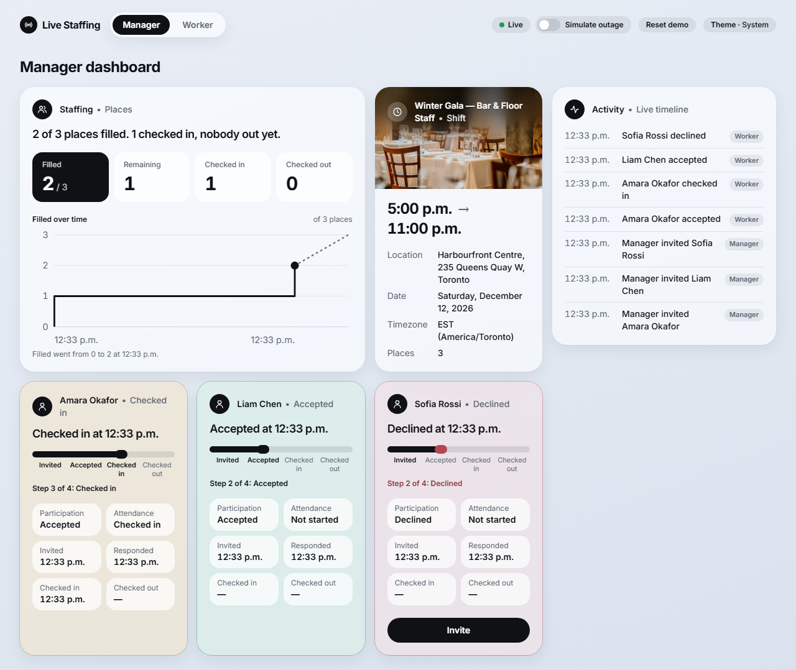
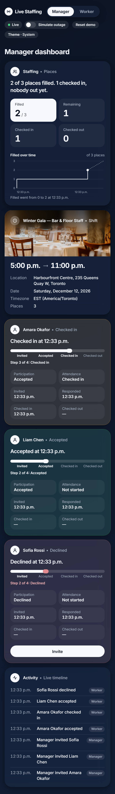
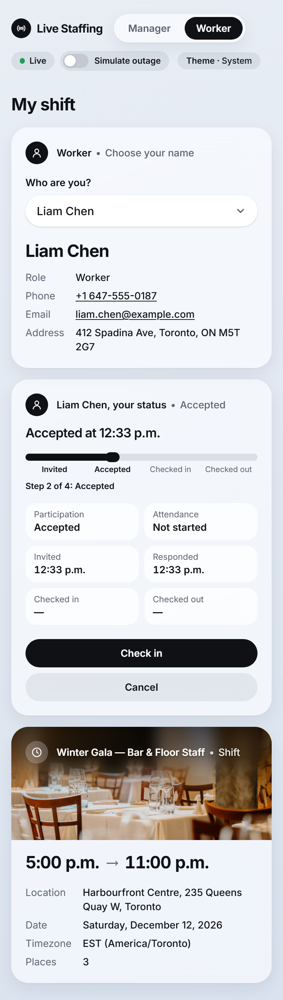
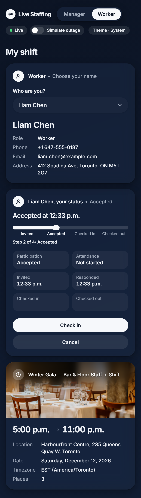
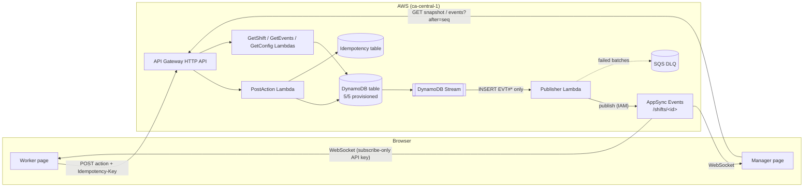

# Live Staffing Dashboard

A worker view and a manager dashboard for one event shift. A manager invites workers, workers accept or
decline, then check in and check out, and every open page sees each change within a few hundred
milliseconds without a refresh. Built on AWS serverless, and also runs entirely on a laptop with no
AWS account.

**Live demo:** <https://auvf58yune.execute-api.ca-central-1.amazonaws.com/manager> (manager) and
[`/worker`](https://auvf58yune.execute-api.ca-central-1.amazonaws.com/worker) (worker). Open both side by side.
The URL is the stack's `SiteUrl` output; see [Site hosting](#site-hosting-temporary) for why it is an `execute-api` URL.



- [Pages and design](#pages-and-design)
- [Quick start (local)](#quick-start-local)
- [Deploy to AWS](#deploy-to-aws)
- [Reset](#reset)
- [Architecture](#architecture)
- [Technology choices and alternatives](#technology-choices-and-alternatives)
- [Testing](#testing)
- [Measurements](#measurements)
- [Challenges and learnings](#challenges-and-learnings)
- [Limitations and improvements](#limitations-and-improvements)
- [Cost and teardown](#cost-and-teardown)
- [AI usage log](#ai-usage-log)
- [Interview prep: rehearsed live changes](#interview-prep-rehearsed-live-changes)

## Pages and design

|                                 Manager, phone, dark                                 |                              Worker, phone, light                               |                              Worker, phone, dark                              |
| :----------------------------------------------------------------------------------: | :-----------------------------------------------------------------------------: | :---------------------------------------------------------------------------: |
|  |  |  |

- **Manager** (`/manager`): the page uses the full browser width with a small gutter each side. A grid of
  cards, one column on phones and up to three on desktops; on wide screens (1280 px and up) Activity is a
  sticky 360 px rail on the right that stays in view while you scroll, with its list scrolling inside it.
  Below that width Activity is the last, full-width card.
  - **Staffing:** the state in one sentence ("2 of 3 places filled. 1 checked in, nobody out yet."), then big
    numbers for Filled, Remaining, Checked in and Checked out. The numbers are selectable tiles (Filled by
    default); the selected one is dark and the small **… over time** chart below (plain SVG) shows that count,
    built from the event log. A dotted line runs from the latest point to the target (Filled up to the required
    count, Remaining down to 0). Every whole number on the Y axis is labelled with a faint gridline. The chart has
    a text alternative ("Checked in went from 0 to 2 between 3:01 p.m. and 3:05 p.m.").
  - **Shift:** a restaurant photo under the title (white over a blurred, darkened band) that fills the card's
    free height, then the time range in large type and location, date and timezone, all in the shift's timezone.
  - **One card per worker:** name • status, a sentence about the latest change ("Accepted at 3:04 p.m."), a
    parcel-style tracker (Invited → Accepted → Checked in → Checked out; a decline or cancel stops the bar in
    muted red and says so in words), participation, attendance and all four timestamps, and **Invite** as a
    full-width pill when allowed. Manager actions are never optimistic.
  - **Activity:** the last 50 changes, newest first. It loads the end of the event log once, then takes each
    live or caught-up event as it arrives; after an outage the catch-up fills the gap in order.
- **Worker** (`/worker`): a "Who are you?" picker (a themed, keyboard-friendly dropdown, no UI library), then
  the chosen worker's name in large type with their role, phone, email and address (made-up demo details from
  the seed, restored by Reset demo), and the worker's own card in the same style. Actions are
  full-width pills: the step forward (Accept, Check in, Check out) is black, the others grey. Actions are
  optimistic: the expected row (predicted with the same domain rules the server runs) shows at once; a refusal
  puts the previous row back and shows the server's message.
- **Design:** a soft blue-grey gradient backdrop (deep navy in dark mode), translucent blurred cards with a
  24 px radius and a soft shadow instead of borders, Inter (bundled with the app, no request to Google), and
  monochrome actions. Colour is kept for state only: muted red for a stop or an error, a green dot for Live,
  amber while reconnecting. Five small hand-drawn SVG icons, no icon or chart library.
- **Photo credit:** the Shift card's restaurant photo is by
  [Guillaume DHALLUIN](https://unsplash.com/@lephotographelillois) on
  [Unsplash](https://unsplash.com/photos/a-formal-dining-room-with-set-tables-N1IlIbAjfzs), used under the
  [Unsplash License](https://unsplash.com/license). It is bundled with the app (a 131 KB webp), so it also loads
  offline in local mode, and is decorative (empty alt text).
- **Theme:** follows the system setting; the header's Theme pill overrides it, each click moving System → Light
  → Dark → System (remembered in `localStorage` when available). Colours are CSS variable tokens, defined once for light and twice for dark (system and
  override).
- **Accessibility:** every card is a region named by its title, the tracker and the chart are exposed as text,
  status is never shown by colour alone, every control has a visible focus ring, transitions switch off under
  `prefers-reduced-motion`, and blur falls back to a solid surface where it isn't supported. Nothing scrolls
  sideways at 400 px. The e2e suite runs axe-core (WCAG 2.1 AA) on both pages in light and dark at desktop and
  400 px widths.

`pnpm screenshots` regenerates the images in `docs/screenshots/` (and fails if a page scrolls sideways at 400 px).

## Quick start (local)

Requirements: Docker, Node 22 and pnpm 10 (`corepack enable` gives you the pinned pnpm).

```sh
pnpm install
docker compose up -d --wait   # DynamoDB Local + local API and live channel + Vite on http://localhost:5173
pnpm reset                    # creates the tables and seeds one shift with three Uninvited workers
```

Open <http://localhost:5173/manager> in one window and <http://localhost:5173/worker> in another, choose a
name on the worker page, and press **Invite** on the manager page. The worker page updates on its own.

Live updates work exactly as in the cloud. Source is bind-mounted: API changes restart the server and page
changes hot-reload within seconds. Without the `app` container, run `pnpm db:up` then `pnpm dev`
(API on :3001, web on :5173, proxied the same way).

| Command                                    | What it does                                                               |
| ------------------------------------------ | -------------------------------------------------------------------------- |
| `pnpm lint && pnpm typecheck && pnpm test` | Lint, types, unit, component and integration tests                         |
| `pnpm e2e`                                 | Playwright end-to-end suite against the running local app                  |
| `pnpm smoke:local`                         | One action, checked to arrive over the local WebSocket                     |
| `pnpm measure`                             | Update-delay and recovery measurements (see [Measurements](#measurements)) |

## Deploy to AWS

Region `ca-central-1`, AWS profile `staffing`. Everything is sized for the free tier (see
[Cost](#cost-and-teardown)) and tagged `project=live-staffing`.

**One-time setup (laptop):**

```powershell
$env:BUDGET_ALERT_EMAIL = "you@example.com"   # never committed
pnpm bootstrap:aws                             # cdk bootstrap + BootstrapStack
gh variable set AWS_DEPLOY_ROLE_ARN --body "arn:aws:iam::<account>:role/live-staffing-github-deploy"
```

`BootstrapStack` creates the GitHub OIDC provider, the `live-staffing-github-deploy` role and a monthly cost
budget that emails at $0.01 actual and $1 forecast. (CloudFormation won't accept absolute thresholds below
0.1, so the alerts are 1% and 100% of a $1 budget.) If the account already has a GitHub OIDC provider, set
`GITHUB_OIDC_PROVIDER_ARN` to reuse it. The role ARN is a repository **variable**, not a secret.

**Deploying:**

```powershell
$env:AWS_PROFILE = "staffing"
pnpm run deploy          # builds the web app, deploys AppStack, prints SiteUrl / ApiUrl / TableName
pnpm run deploy:hotswap  # dev only: pushes Lambda code changes in seconds, bypassing CloudFormation
```

Use `pnpm run deploy`, not `pnpm deploy` (a built-in pnpm command). The stack seeds the shift when it is
first created, so a fresh deploy works without `reset`.

**CI/CD** (`.github/workflows/ci.yml`):

- **Every push and pull request:** lint, typecheck, unit and integration tests (DynamoDB Local service
  container). This job has `contents: read` only and never receives AWS credentials.
- **Every push and pull request, local mode:** `docker compose up --wait`, `pnpm reset`, the local smoke
  test, then the Playwright suite. No AWS credentials.
- **Push to `main`, after checks pass:** assumes the deploy role through OIDC (no stored AWS keys),
  deploys `AppStack`, then smoke-tests `GET <SiteUrl>/api/shifts/<id>` and one live update over AppSync Events.

The deploy role trusts only `main` of this repo, through GitHub's immutable OIDC subject
(`repo:tarekFerdous@55275853/live-staffing-dashboard@1453375278:ref:refs/heads/main`), so a renamed or
re-created repo with the same name can't match. Its only permission is `sts:AssumeRole` on the `cdk-*` roles
that `cdk bootstrap` created. Forks deploying to their own account change `GITHUB_SUBJECT_PREFIX` in
`packages/infra/lib/config.ts`.

### Site hosting (temporary)

The account can't create CloudFront distributions until AWS Support verifies it, so the built app ships as a
Lambda layer and a small `Site` Lambda serves it on catch-all `GET /` and `GET /{proxy+}` routes of the same
HTTP API. The `/api/*` routes are more specific and always win, so page and API still share one origin with
no CORS. Assets under `/assets/` are cached for a year. The CloudFront + S3 version is in commit `706197f`;
`todo.md` says how to restore it.

## Reset

The seed is one shift (Winter Gala, Harbourfront Centre, 17:00–23:00 America/Toronto, 3 places) and three
Uninvited, Not started workers, with `seq` 0 and an empty event log. There are three ways back to it, and
they all run the same store code:

- **The Reset demo button** in the manager dashboard's header, next to "Simulate outage". It opens a
  confirmation modal (a native `<dialog>`, Cancel focused by default) that says exactly what is lost. On
  success the modal closes, the outage simulation switches off and a "Demo reset" toast appears.
- **`POST /api/demo/reset`** (no body): resets every seeded shift and answers
  `200 { shifts: [{ id, epoch }] }`. A repeated call simply resets again.
- **The CLI:** `pnpm reset` (local; creates the tables if needed) or `pnpm reset --stage` (the deployed table,
  `staffing` profile).

**Every open page snaps back on its own, without a refresh.** A reset puts `seq` back to 0, which an open
page would otherwise treat as older than what it holds. So the shift's META also carries an **epoch**,
bumped by every reset:

1. The reset deletes META first (from then on an action answers `SHIFT_NOT_FOUND` instead of half-applying),
   then the workers and the event log, writes the seed workers, and writes META last with `epoch + 1`.
   That last write is the moment the reset takes effect. It isn't one transaction, because the log can be
   longer than the transaction item limit; the META-first / META-last order is what keeps it safe.
2. The stream filter passes META inserts as well as new events (actions only ever update META, so an insert
   means a reset), and the publisher turns one into `{ kind: 'reset', epoch }` on the shift's channel.
   Events carry `kind: 'event'` and the epoch they were made in.
3. A page that sees a newer epoch, in a live reset message, a catch-up response or a refetched snapshot,
   adopts the server's snapshot even though its `seq` is lower. It drops pending optimistic actions (and any
   answer to one that comes back after the reset), and clears its timeline. Older epochs never roll a page
   back, and events from an older epoch delivered late are dropped. A page that was offline or in outage
   during the reset notices the new epoch on its first catch-up after reconnecting.

The endpoint has no authentication: it is a demo affordance so a presenter or reviewer can start over
without a terminal. A real product would put it behind an admin role or remove it.

## Architecture



| Package              | What it holds                                                                                          |
| -------------------- | ------------------------------------------------------------------------------------------------------ |
| `packages/domain`    | Statuses, transition table, `applyAction`, `deriveCounts`, Zod schemas. No AWS or React imports.       |
| `packages/store`     | DynamoDB single-table repository, seed data, reset script, test helpers.                               |
| `packages/functions` | Lambda handlers, the stream publisher, and a local HTTP + WebSocket adapter that calls the same code.  |
| `packages/web`       | React + Vite + TanStack Query + Tailwind. Routes `/manager` and `/worker`.                             |
| `packages/infra`     | CDK: `BootstrapStack` (OIDC role, budget) and `AppStack` (tables, API, Lambdas, AppSync Events, site). |
| `packages/e2e`       | Playwright suite and the measurement scripts.                                                          |

### Data model

One partition per shift (`PK = SHIFT#<id>`):

| SK            | Item                                                                                          |
| ------------- | --------------------------------------------------------------------------------------------- |
| `META`        | title, location, startsAt/endsAt (UTC), timezone (IANA), required, `seq`, `acceptedCount`     |
| `WORKER#<id>` | name, participation, attendance, four timestamps, `version`                                   |
| `EVT#<seq>`   | append-only event log: `{ seq, type, workerId, actor, row, at }` with the full new worker row |

A worker's state is two independent fields: **participation** (Uninvited → Invited → Accepted / Declined →
Cancelled) and **attendance** (Not started → Checked in → Checked out). The allowed moves are one table of
data in `packages/domain/src/transitions.ts`, used by the server, the optimistic client and the UI's button
list alike.

Sort keys order as `EVT#…` < `META` < `WORKER#…`, so the snapshot is a single Query with `SK >= "META"` and
never reads the event log. Counts are never stored for display: the client derives them from the worker rows
with `deriveCounts`. (`acceptedCount` on META exists only to enforce capacity atomically.)

### Update mechanism

1. A worker presses **Accept**. The page shows the expected result at once (optimistic, predicted by the same
   domain rules) and sends `POST /api/shifts/{shiftId}/workers/{workerId}/actions` with an
   `Idempotency-Key`.
2. The action Lambda commits the change and its event in one transaction (see below) and answers with the
   committed row and its `seq`.
3. The table's stream delivers the new `EVT#` item to the publisher Lambda. The event source mapping filters
   to `EVT#` inserts only, so a rolled-back transaction never reaches anyone.
4. The publisher posts the event to the AppSync Events channel `/shifts/<id>`; every subscribed page receives it
   over its WebSocket.
5. Each page's sync module applies an event only if it is exactly the next `seq`. A duplicate is dropped; a
   gap triggers a catch-up read of `GET …/events?after=<seq>` (single-flight, oldest first, falling back to
   a fresh snapshot after 200 events).
6. A push can be lost: AppSync Events delivers at most once, and now and then a single subscriber misses a
   message the others get. A lost event in the middle of a burst shows up as a gap when the next one
   arrives, but a lost _last_ event (or the only one) has nothing after it. So while Live the page also
   reads what it missed 1.5 s after a burst of live events goes quiet and every 6 s otherwise: one small,
   usually empty read. A lost push then costs a few seconds of delay instead of a stale screen.

On connect and on every reconnect the page **subscribes first, then reads what it missed**, so nothing
committed between the read and the subscription is lost. Reconnects use jittered exponential backoff
(250 ms doubling to 5 s). While the page isn't Live, its action buttons are disabled with a notice explaining
why, so nothing is sent from an out-of-date screen. The header's **Simulate outage** switch closes the live
connection on purpose so recovery can be shown (and tested).

Locally, the same publisher code is driven by a change feed that polls DynamoDB Local's stream API, and an
in-process `ws` server speaks the AppSync Events WebSocket protocol. The page reads `GET /api/config` at
start-up to find its live channel, so one web build runs in both modes:

| Port              | Cloud                                          | Local                                                       |
| ----------------- | ---------------------------------------------- | ----------------------------------------------------------- |
| `AssignmentStore` | DynamoDB                                       | DynamoDB Local (same code, other endpoint)                  |
| `ChangeFeed`      | DynamoDB Streams → Lambda event source mapping | polls DynamoDB Local's stream API (`local/changeFeed.ts`)   |
| `Publisher`       | AppSync Events HTTP publish (SigV4)            | in-process `ws` server speaking the AppSync Events protocol |

### Safe writes

Each action is one read of META and the worker row, followed by a single `TransactWriteItems`:

1. **Worker row:** updated only from an allowed from-state and the version that was read. It gets
   `version + 1`; its timestamp is set with `if_not_exists`, so a timestamp is never overwritten.
2. **META:** `seq = seq + 1`, only if `seq` still has the value that was read. `accept` also requires
   `acceptedCount < required` and adds 1; `cancel` subtracts 1.
3. **Event:** puts `EVT#<seq>` with the full new row.

If another write got in first, the Lambda re-reads and decides again, up to 3 retries with jittered backoff.
Timestamps come from the Lambda's clock, not the browser's: a client clock can be wrong, and a retried request
would carry a different time.

| Outcome                                                   | Response                                                      |
| --------------------------------------------------------- | ------------------------------------------------------------- |
| Applied                                                   | `200 { worker, seq }`                                         |
| Already in the target state (double click, lost response) | `200 { worker }` with the stored row, no new event            |
| Stale `expectedVersion`                                   | `409 VERSION_CONFLICT` with `current`                         |
| Not allowed from the current state                        | `409 INVALID_TRANSITION` with `current` and a readable reason |
| No free place                                             | `409 SHIFT_FULL`, "No places left"                            |
| Malformed body or missing key                             | `422` (key not recorded)                                      |
| Same key, different body                                  | `422 IDEMPOTENCY_KEY_REUSED`                                  |

Idempotency uses Powertools for AWS Lambda, keyed on the `Idempotency-Key` header plus the path, with records
in their own table (1-hour TTL). A repeated key returns the byte-identical first response. The web client makes
one key per click and reuses it on its automatic retries, and blocks a second click while one is in flight.

## Technology choices and alternatives

| Choice                                  | Why                                                                                                                                                                                | Alternatives considered                                                                                                                                                                                                                                                                                                                                                                                                                                                                          |
| --------------------------------------- | ---------------------------------------------------------------------------------------------------------------------------------------------------------------------------------- | ------------------------------------------------------------------------------------------------------------------------------------------------------------------------------------------------------------------------------------------------------------------------------------------------------------------------------------------------------------------------------------------------------------------------------------------------------------------------------------------------ |
| **Lambda + API Gateway HTTP API**       | Pay per request, nothing idle to pay for, no servers to patch. Cold starts (~2 s on the update path, measured below) are the cost.                                                 | **A container** (Fastify on ECS Fargate or App Runner, WebSockets in-process, Postgres or DynamoDB). Simpler mental model, no cold starts, one process for HTTP and live push. Rejected because it costs money around the clock (Fargate + ALB ≈ $20–30/month), and an always-on process with in-memory subscribers needs sticky sessions or a pub/sub layer as soon as there are two instances. The ports in `functions` keep the door open: the local server already is that container design. |
| **DynamoDB, single table**              | Conditional writes and transactions give exactly the guarantees needed (versioned rows, atomic capacity, ordered log) with no connection pooling from Lambda. Free tier covers it. | **Aurora Serverless / RDS Postgres**: `SELECT … FOR UPDATE` would be natural, but it is not free, and Lambda-to-RDS connections need RDS Proxy.                                                                                                                                                                                                                                                                                                                                                  |
| **DynamoDB Streams → publisher**        | Only committed changes are published (a cancelled transaction writes nothing), so the live feed can never show something that didn't happen. Retries and a DLQ come for free.      | Publishing from the action Lambda after the write: faster by one hop, but a crash between commit and publish loses the event, and a publish before commit could announce a rolled-back change.                                                                                                                                                                                                                                                                                                   |
| **AppSync Events**                      | Managed WebSocket fan-out to channels, no connection table to maintain, IAM-only publish and a subscribe-only key.                                                                 | **API Gateway WebSocket API**: you store connection ids and post to each one yourself. **IoT Core MQTT**: capable but heavier client. **Server-sent events / polling**: simple, but polling costs requests and SSE needs a long-lived server.                                                                                                                                                                                                                                                    |
| **Per-shift `seq` + catch-up endpoint** | Gives every change a total order, so clients can detect duplicates and gaps and recover deterministically.                                                                         | Re-fetching the snapshot on every message: simpler, but more reads and no ordering guarantee between messages.                                                                                                                                                                                                                                                                                                                                                                                   |
| **React + TanStack Query + Tailwind**   | The query cache is the single source of truth for the page; the sync module and optimistic actions both write to it.                                                               | Plain fetch + `useState` (re-invents caching and retries); Redux (more ceremony for the same thing).                                                                                                                                                                                                                                                                                                                                                                                             |
| **CDK in TypeScript**                   | Same language as the app; the seed and the stream filter import constants straight from the store package.                                                                         | SAM / Serverless Framework (YAML, less type safety); Terraform (another language and state backend).                                                                                                                                                                                                                                                                                                                                                                                             |
| **Playwright**                          | Two browser contexts in one test, WebSocket routing for the stale-page test, and a library mode reused by the measurement script.                                                  | Cypress (one tab per test makes two sessions awkward).                                                                                                                                                                                                                                                                                                                                                                                                                                           |

## Testing

```sh
pnpm lint && pnpm typecheck && pnpm test   # unit, component, integration, infra
pnpm e2e                                   # end to end, against `docker compose up` (or BASE_URL)
```

| Layer                        | What it proves                                                                                                                                                                                                                                                                                                                                                                                                                                                                                                                     | Where                                                                               |
| ---------------------------- | ---------------------------------------------------------------------------------------------------------------------------------------------------------------------------------------------------------------------------------------------------------------------------------------------------------------------------------------------------------------------------------------------------------------------------------------------------------------------------------------------------------------------------------- | ----------------------------------------------------------------------------------- |
| Domain unit                  | The transition table covers every state combination, every allowed and refused move, counts, capacity, purity (no AWS/React imports)                                                                                                                                                                                                                                                                                                                                                                                               | `packages/domain`                                                                   |
| Store integration            | Seed and reset, the epoch (starts at 1, +1 per reset), an action while META is gone mid-reset answers SHIFT_NOT_FOUND, the snapshot never reads the event log, table definitions                                                                                                                                                                                                                                                                                                                                                   | `packages/store` against DynamoDB Local (Testcontainers, or CI's service container) |
| Handler integration          | Every action through the real store: refusals with reasons, set-once timestamps, `acceptedCount` always equal to the derived count, idempotency (same key replays byte-identical, reused key refused), version conflicts, 20 parallel identical requests → one event, 3 workers racing for 2 places → exactly 2 accepted, `POST /api/demo/reset` (repeatable, epoch in snapshot and catch-up)                                                                                                                                      | `packages/functions` against DynamoDB Local                                         |
| Publisher and local adapters | `EVT#` inserts become events and `META` inserts reset messages, nothing else is published, per-hop timings, the local change feed (a reset included) and WebSocket protocol                                                                                                                                                                                                                                                                                                                                                        | `packages/functions`                                                                |
| Client sync                  | In-order apply, duplicates, gaps and catch-up, reconnect backoff, outage, offline, resets: a newer epoch adopts the lower-seq snapshot, older epochs and late pre-reset events are ignored, a reset missed in an outage is found on catch-up (fake transport and clock)                                                                                                                                                                                                                                                            | `packages/web/src/lib/sync`                                                         |
| Pages                        | What the manager and worker see per state, optimistic rollback, live updates, timeline, theme, both pages snapping back after a reset (a pending optimistic action dropped), the Reset demo modal (exact text, focus, Cancel / Escape / backdrop, one request on a double click, error inside the modal)                                                                                                                                                                                                                           | `packages/web/src/pages` (fake API)                                                 |
| Infra                        | Stream filter, IAM boundaries, routes, budget, OIDC trust                                                                                                                                                                                                                                                                                                                                                                                                                                                                          | `packages/infra/test` (CDK assertions)                                              |
| UI logic                     | The staffing sentence for every count combination, the filled-over-time series, the tracker text for every participation × attendance combination, the card shell, and the stylesheet's tokens (light and both dark sets match, no violet left, Inter bundled)                                                                                                                                                                                                                                                                     | `packages/web/src/lib`, `components`                                                |
| **Accessibility**            | axe-core (WCAG 2.1 AA, contrast included) on both pages in light and dark, at desktop and 400 px; no sideways scroll at 400 px; every card a named region; every control reached by Tab with a visible focus ring                                                                                                                                                                                                                                                                                                                  | `packages/e2e/tests/accessibility.spec.ts`                                          |
| **End to end**               | Two real browser sessions against the running app: full lifecycle live across sessions; decline, re-invite, cancel and re-accept; only allowed buttons per state; a refused action rolled back with the server's message; double clicks never create a second event or change a timestamp; three changes made during a manager outage all appear after reconnecting; state survives a refresh; a reset from the modal (or `pnpm reset`) puts both open pages back to the seed without a refresh, and cancelling it changes nothing | `packages/e2e/tests`                                                                |

The end-to-end suite resets the shift before every test and targets local mode by default, or the deployed
stage when `BASE_URL` is set (`BASE_URL=<SiteUrl> pnpm e2e`, which resets with `pnpm reset --stage`). It runs
in CI against local mode. The refused-action test needs a page that is genuinely out of date while still
showing Live, so it routes that page's WebSocket through Playwright and drops change messages after a point.

## Measurements

Produced by `pnpm measure` (local) and `pnpm measure --stage`, written to `packages/e2e/results/*.json`, and
rendered into the table below by `pnpm measure:render`, so no number here is typed by hand.

- **Update delay:** the worker clicks Accept or Cancel (alternating, 100 runs) → the manager's page shows the
  new status. Both moments are timestamped inside the browser (`performance.timeOrigin + performance.now()`);
  both pages run in one browser on one machine, so they share a clock and Playwright's own round trips are
  not counted.
- **Recovery:** with the manager in simulated outage, the worker makes 3 changes; the manager switches the
  outage off → its page matches the server snapshot (status and Filled count). 20 runs.
- **Cold start:** on the stage, the script forces fresh instances of the action and publisher Lambdas
  (by touching an environment variable; the next deploy puts the template's back) and reports the first
  action on its own row.
- Runs are sequential with a pause in between, so the provisioned 5/5 table is never throttled; the script
  reads the table's throttle metrics for the run window to confirm it.

<!-- measurements:start -->

| Metric                                            |       Local (docker compose) | Cloud (ca-central-1) |
| ------------------------------------------------- | ---------------------------: | -------------------: |
| Update delay p50                                  |                       102 ms |               230 ms |
| Update delay p95                                  |                       110 ms |               681 ms |
| Update delay max                                  |                       124 ms |               802 ms |
| Update delay runs                                 |                          100 |                  100 |
| Recovery p50                                      |                        28 ms |               204 ms |
| Recovery p95                                      |                        32 ms |               282 ms |
| Recovery max                                      |                        33 ms |               324 ms |
| Recovery runs                                     |                           20 |                   20 |
| Cold start (first action, not in the percentiles) | n/a (no cold starts locally) |              2530 ms |
| DynamoDB throttle events during the run           |                          n/a |                    0 |

Cloud path per hop (Powertools metrics read back from CloudWatch for the same run):

| Hop                                                                               |    p50 |    p95 |    max | samples |
| --------------------------------------------------------------------------------- | -----: | -----: | -----: | ------: |
| Action Lambda: request in → response out                                          |  49 ms |  97 ms | 371 ms |     160 |
| Event timestamp → publisher starts (DynamoDB write, stream, event source mapping) | 111 ms | 509 ms | 539 ms |     160 |
| Publisher → AppSync Events HTTP publish                                           |  49 ms | 125 ms | 255 ms |     160 |

The rest of the update delay is the browser → API Gateway → Lambda round trip and AppSync fan-out to the
manager's WebSocket and React rendering. The command and commit-to-publisher hops overlap: the event's
timestamp is taken inside the action Lambda.

- **Local**, measured 2026-11-11 11:49 UTC (41 s): Windows_NT 10.0.26200 (x64), AMD Ryzen 7 9800X3D 8-Core Processor × 8, 31 GB, Node v22.18.0, Chromium 158.0.8127.18 (headless). Sequential runs, 200 ms apart, docker compose local mode on this machine.
- **Cloud**, measured 2026-11-11 11:58 UTC (163 s): Windows_NT 10.0.26200 (x64), AMD Ryzen 7 9800X3D 8-Core Processor × 8, 31 GB, Node v22.18.0, Chromium 158.0.8127.18 (headless). Sequential runs, 1000 ms apart, browser on this machine → ca-central-1.

<!-- measurements:end -->

Locally, most of the update delay is the change feed's 100 ms poll of DynamoDB Local's stream.

## Challenges and learnings

- **The snapshot query in the PRD matched nothing.** It said `SK < "EVT#"`, but `META` and `WORKER#` sort
  after `EVT#`. The fix (`SK >= "META"`) came from writing the integration test first.
- **Pages must subscribe before they read.** Reading the snapshot first leaves a window where a change is
  committed but neither in the snapshot nor received live. Subscribing first and then catching up from the
  snapshot's `seq` closes it; the sync's ordering by `seq` makes the overlap harmless.
- **A cancelled transaction must never be pushed.** Publishing from the stream, filtered to new event items,
  gives that for free; publishing from the action Lambda would not.
- **CloudFront was blocked by an account verification**, which stopped every deploy. Serving the built app from
  a Lambda on the same HTTP API kept one origin (no CORS) and unblocked the rest of the work; restoring
  CloudFront is a contained change (`todo.md`).
- **GitHub's immutable OIDC subject** (`owner@id/repo@id`) broke the first CI deploy, because the role trusted
  the legacy `owner/repo` form. Trusting only the immutable form is also the safer choice.
- **A reset didn't reach open pages.** It puts `seq` back to 0, which an open page treated as old. The e2e
  suite found a sharper version: on the stage, the stream can deliver the previous test's last events a moment
  _after_ a reset, and a freshly opened page took them as new. The fix is an epoch on the shift, on every
  event and in every catch-up response (see [Reset](#reset)); the tests needed a drain wait until then.
- **Reads conflict too.** Two actions a few milliseconds apart (two quick Invite clicks) sometimes got a 500.
  The store retried a _write_ that DynamoDB cancelled with `TransactionConflict`, but the consistent
  `TransactGetItems` _read_ of META and the worker row fails the same way while another action's transaction
  is still writing META, and that wasn't caught. DynamoDB Local never produces these conflicts, so only the
  stage e2e run showed it. A conflicted read is now retried like a conflicted write, with tests that inject
  the conflict. (My first guess, an `instanceof` mismatch between two copies of the AWS SDK, didn't fix it;
  the cancellation reasons in the log had two entries, matching the two-item read rather than the
  three-item write. The store now also matches the error by name, which is harmless and avoids that trap.)
- **A live push can go missing.** On the stage, the e2e suite caught a page that showed an accept but never
  the check-in published 100 ms later. The publisher's logs showed both publishes succeeding and the DLQ was
  empty, so the message was lost between AppSync Events and the browser; another run showed one page missing
  an event two other pages received. Gap detection only notices a lost event when a later one arrives, so a
  Live page now also reads what it missed after a burst goes quiet and every 6 s.
- **Measuring honestly.** Timing from Node adds Playwright's round trips to every sample; timing inside the
  browser on both pages doesn't, and still has no clock skew because both pages share one machine.

## Limitations and improvements

- **One shift, seeded.** No shift creation UI or multi-shift navigation (the data model and channels are
  per shift already).
- **No authentication.** Anyone can act as any worker or as the manager; the live channel uses a public
  subscribe-only key. Next: Cognito users with a `workerId` claim, a manager group, and an AppSync Events
  Lambda authorizer per channel.
- **Writes to one shift are serialized** by its `seq`. Fine for a handful of people; at sustained concurrent
  writes to the same shift (tens per second) retries pile up. Then: guard capacity separately and order
  events per worker.
- **Cold starts** add about two seconds to the first action after idle. Provisioned concurrency would remove it
  but isn't free.
- **Every open page reads the event log every 6 s** as a safety net for lost pushes. That is about 0.1 read
  units per second per page against the table's 5: plenty for a demo, but dozens of open pages would need
  on-demand capacity, a longer interval, or reads from a cache.
- **The reset endpoint is open to anyone** (see [Reset](#reset)): fine for a demo, not for a product.
- **No CloudFront yet** (account verification), so the site is served by a Lambda: one extra invocation per page
  or asset load, no edge caching.
- **Latency badge is approximate:** it compares the server's clock with the browser's.

## Cost and teardown

Everything fits in AWS's free tier for a demo's traffic:

| Resource             | Sizing                                                                          | Free tier                                                                           |
| -------------------- | ------------------------------------------------------------------------------- | ----------------------------------------------------------------------------------- |
| DynamoDB             | shift table 5 RCU / 5 WCU, idempotency table 3 / 3 (provisioned, not on-demand) | 25 RCU / 25 WCU and 25 GB always free                                               |
| DynamoDB Streams     | read by the event source mapping                                                | stream reads by Lambda triggers are free                                            |
| Lambda               | 6 app functions (plus CDK's seeding helper), arm64, 256 MB                      | 1M requests and 400,000 GB-s per month, always free                                 |
| API Gateway HTTP API | one API                                                                         | 1M calls per month for the first 12 months                                          |
| AppSync Events       | one API, one channel namespace                                                  | 250,000 operations and 600,000 connection-minutes per month for the first 12 months |
| CloudWatch           | 7-day log retention; 3 custom metrics (EMF)                                     | 5 GB logs and 10 custom metrics always free                                         |
| SQS                  | one DLQ                                                                         | 1M requests per month always free                                                   |

The budget in `BootstrapStack` emails at **$0.01** of actual spend and at a **$1** forecast, so any charge is
noticed the same day. Provisioned (not on-demand) capacity keeps DynamoDB inside the free tier and caps what a
runaway client could cost; the measurement script paces its runs to stay within it.

**Teardown:**

```sh
pnpm destroy                                                   # removes AppStack, tables and logs included
aws cloudformation delete-stack --stack-name LiveStaffingBootstrap --profile staffing   # OIDC role and budget
```

## AI usage log

The project was built with Claude Code (Claude Opus, with Sonnet for one milestone) between
2026-11-10 20:12 and 2026-11-11 (Eastern time; see the commit history). Requirements were written first as PRDs and
issues (`gh issue list`), then each milestone was implemented issue by issue, tested, and reviewed by me in a
QA pass before committing. Commits are co-authored by the model that wrote them.

What I accepted, changed or rejected, with concrete examples:

|                        | Suggestion                                                                                                                                                                                  | What happened                                                                                                                                                                                                                             |
| ---------------------- | ------------------------------------------------------------------------------------------------------------------------------------------------------------------------------------------- | ----------------------------------------------------------------------------------------------------------------------------------------------------------------------------------------------------------------------------------------- |
| **Changed**            | The PRD's snapshot query `SK < "EVT#"`.                                                                                                                                                     | Wrong: `META` and `WORKER#` sort after `EVT#`, so it matched nothing. The integration test caught it; changed to `SK >= "META"`, and the reason is documented in the code and this README.                                                |
| **Changed**            | Trust the legacy `repo:owner/name:ref:…` OIDC subject in the deploy role.                                                                                                                   | The first CI deploy failed because the repo uses GitHub's immutable subject. Changed to trust only `owner@id/repo@id`, which is also safer against a re-created repo.                                                                     |
| **Accepted**           | Timestamps set by the Lambda with `if_not_exists`, never by the browser, so a re-invite keeps the first `invitedAt` and a re-accept the first `respondedAt` (an open question from PRD #3). | Accepted: it makes double clicks and retries provably harmless (the e2e test checks the timestamps don't move).                                                                                                                           |
| **Changed**            | The e2e test for a refused action expected the "Can't accept …" (invalid transition) message.                                                                                               | The server answered "status changed since you loaded it" instead, which is right: the page sends the row version it showed, so a stale page gets a version conflict first. Changed the test, not the server.                              |
| **Changed**            | An e2e reset in a `beforeEach` inside the shared helper module.                                                                                                                             | Only the first spec file got it (the module is loaded once), so later files ran on leftover data. Changed to an auto fixture after a failing run showed the previous test's events.                                                       |
| **Changed**            | Measure update delay in Node around Playwright calls.                                                                                                                                       | Changed to timestamps taken in the browser on both pages, so Playwright's round trips aren't counted.                                                                                                                                     |
| **Rejected**           | Waiting for CloudFront verification before deploying anything.                                                                                                                              | Rejected in favour of serving the site from a Lambda on the same API, so the rest of the work could be deployed and tested; CloudFront comes back from commit `706197f`.                                                                  |
| **Accepted, deferred** | Fix stale pages after a reset with an epoch on the shift.                                                                                                                                   | Agreed, but scoped as its own PRD (#29) rather than slipped into the test work; the e2e suite worked around it explicitly until that PRD landed.                                                                                          |
| **Changed**            | Read a missing timeline entry as a test timing problem.                                                                                                                                     | The trace showed a 500 on a concurrent invite. A first fix (an `instanceof` theory) didn't help; the log's two cancellation reasons pointed at the two-item read, which wasn't retried. Fixed in the store instead of loosening the test. |
| **Changed**            | PRD #29's epoch on META and on reset messages only.                                                                                                                                         | Also stamped every event with its epoch: a pre-reset event with seq 1 delivered late would otherwise look like the next change on a freshly reset page. That is the exact flake the stage e2e run had shown.                              |

## Interview prep: rehearsed live changes

Each is a small, contained change; the files to touch are listed so it can be done live.

1. **Add a No-show attendance state.** Add `no_show` to `ATTENDANCES` and its label (`domain/src/statuses.ts`),
   a `mark_no_show` manager action from Accepted + Not started (`domain/src/transitions.ts`), a timestamp field
   if wanted (`schemas.ts`, store write), count it in `deriveCounts`, and add it to the manager's action list.
   The transition table test fails until every new combination is covered.
2. **Let the manager withdraw an invitation.** One new `withdraw` transition: Invited → Uninvited, actor
   manager, no timestamp, `acceptedDelta: 0`. Add it to `MANAGER_ACTIONS` in `ManagerPage.tsx` and a verb in
   the activity timeline. The server, optimistic client and buttons all read the same table.
3. **Change required to 2.** Edit `SEED.shift.required` (`store/src/seed.ts`) and `pnpm reset`; capacity is
   enforced by the META condition, so the third Accept gets "No places left". (On the stage, `pnpm reset --stage`.)
4. **Add a second shift.** Add a second seed shift, loop the reset over seeds, and choose the shift in the page
   (today `SHIFT_ID` comes from `VITE_SHIFT_ID`). Channels and partitions are already per shift.
